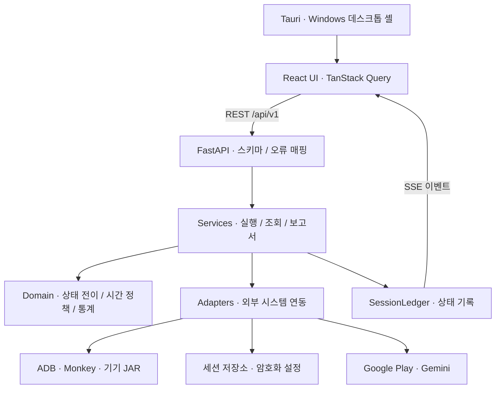

<div align="center">

# Android Monkey Test Platform

**Android 앱 안정성 테스트부터 성능 수집·결과 분석·보고서까지, 하나의 Windows 앱으로.**

`Windows x64` · `Tauri + React` · `FastAPI` · `Android Monkey`

[시작하기](#시작하기) · [아키텍처](#아키텍처와-리팩토링) · [설치 파일 빌드](#설치-파일-빌드) · [운영 가이드](docs/OPERATIONS.md) · [Google Play 연결](docs/GOOGLE_PLAY.md)

</div>

---

USB 또는 무선 ADB로 연결한 Android 단말에 Monkey 이벤트를 주입하고, 크래시·ANR과 성능 지표를 함께 기록하는 QA 도구입니다.
목표 시간에 맞춰 테스트를 실행하고 회차별 Seed·이벤트·종료 사유를 남겨 결과를 추적하고 재현하는 데 필요한 근거를 제공합니다.

## 주요 기능

| 영역 | 제공 기능 |
|---|---|
| 앱 선택 | 단말의 실제 앱 이름·아이콘, 초성·한글 발음·영문·패키지 검색, 아이콘 PC 캐시 |
| 버전 확인 | 설치 버전과 공식 Google Play 출시 정보 비교, Play Console 계정 권한에 따른 조회 |
| 테스트 실행 | 시간 기반 프리셋, 이벤트 소진 시 추가 실행, Seed 지정 재현, 앱 이탈 감지·복귀 |
| 성능 모니터 | 기기 JAR 수집기, 메모리·CPU·FPS·프레임 시간, 시간 범위·회차 필터 |
| 결과 분석 | 크래시·ANR, 평균·최소·최대·표준편차·P90/P95, 표본 충분성 및 수집 공백 확인 |
| AI 분석 | 통계 미리보기와 사용자 동의 후 Gemini 성능 해석, JSON 검증, 분석 결과 캐시 |
| 보고서 | 전체 화면 결과·HTML 탭, 오프라인 SVG 그래프, 엑셀 내보내기 |
| 운영 | 콘솔 로그, 요청·세션 ID 추적, 이전 결과 완전 삭제, 암호화 설정 보관·복원 |

### 시간 기반 프리셋

| 프리셋 | 목표 실행 시간 | 회차 구성 | Throttle |
|---|---:|---:|---:|
| Smoke | 30분 | 6분 × 5회 | 250ms |
| Standard | 1시간 | 10분 × 6회 | 200ms |
| Deep | 3시간 | 18분 × 10회 | 150ms |
| Extreme | 8시간 | 32분 × 15회 | 180ms |

**목표 실행 시간과 전체 소요 시간은 구분합니다.** 앱 준비·프로세스 정리·회차 사이 대기는 별도로 기록되므로 전체 소요 시간은 더 길어질 수 있습니다.
목표 시각은 monotonic clock으로 관리합니다. 이벤트가 먼저 소진되면 실측 속도와 남은 시간으로 할당량을 계산해 같은 회차에서 추가 Monkey 프로세스를 실행합니다.
추가 구간의 Seed와 이벤트 수를 모두 기록하며, 오류나 연결 끊김을 정상 완료로 처리하지 않습니다.

## 시작하기

### 설치 파일 사용자

1. Windows 10/11 x64에서 설치 EXE를 실행합니다.
2. 단말에서 USB 디버깅을 허용한 뒤 USB 또는 무선 ADB로 연결합니다.
3. 앱을 선택하고 프리셋을 지정한 뒤 **테스트 시작**을 누릅니다.
4. **성능 모니터 → 테스트 결과 → HTML 보고서** 탭에서 결과를 확인합니다.

설치 패키지는 Python 런타임, ADB/aapt2, 성능 수집 JAR, 폰트와 WebView2 오프라인 설치 관리자를 포함합니다.
대상 PC에 Python·Node.js·Java·Android SDK를 별도로 설치할 필요가 없습니다. 단말 제조사 USB 드라이버가 필요한 경우는 있습니다.
Google Play 및 Gemini 기능은 인터넷과 해당 서비스의 사용 권한이 필요합니다.

### 소스 개발 환경

Python 3.12+, Node.js 20+, Rust stable/MSVC, Windows C++ 빌드 도구, WebView2와 ADB를 준비합니다.

```powershell
cd frontend
npm ci
npm run setup:backend
npm run tauri dev
```

데스크톱 셸은 `backend/.venv`의 백엔드를 실행합니다. 이미 8765 포트에서 실행 중인 백엔드가 있으면 재사용합니다.
개발 UI는 `http://localhost:5173`, API 문서는 `http://127.0.0.1:8765/docs`에서 확인합니다.
환경 변수와 수집기 재빌드 방법은 [운영 및 개발 상세 가이드](docs/OPERATIONS.md)를 참고하세요.

## 아키텍처와 리팩토링

UI에서 테스트 실행과 보고서 처리를 직접 담당하던 구버전 구조를 **API 중심의 계층 구조**로 분리했습니다.
데스크톱 화면과 자동화 클라이언트는 같은 REST API를 사용하고 테스트 상태의 기준은 백엔드가 관리합니다.



| 개선 영역 | 변경한 구조 | 효과 |
|---|---|---|
| 책임 분리 | `API → Services → Domain`, 외부 I/O는 `Adapters` | 화면과 기기 제어·분석 로직을 독립적으로 변경·검증 |
| 상태 관리 | 세션 변경을 `SessionLedger`로 일원화 | 실행 상태·저장 결과·이벤트 간 일관성 확보 |
| 화면 동기화 | SSE 실시간 반영 + 진행 중 5초 간격 스냅샷 재확인 | 알림 누락 시 진행률과 완료 결과 복구 |
| 시간 제어 | 회차별 단일 종료 시각과 구간별 이벤트 할당 | 초기 이벤트 수가 부족해도 목표 시간까지 실행 |
| 기기 프로세스 | 실행별 PID 추적, 종료 확인, Activity 이벤트 기반 복귀 | 잔여 Monkey와 앱 이탈 대응을 별도 책임으로 관리 |
| 성능 수집 | AppkiumPerf의 필요한 Java 수집기를 독립 포팅 | 원본 프로젝트 없이 JAR 실행·재빌드 가능 |
| 성능 판정 | 통계는 코드로 계산하고 AI는 근거를 해석 | 피크 하나만으로 누수·최적화를 단정하는 평가 완화 |
| API 계약 | OpenAPI + 생성된 TypeScript 타입 + 응답 계약 테스트 | 백엔드·화면 간 형식 불일치 탐지 |
| 배포 | 감시 경로 밖의 소스 사본에서 버전 증가·빌드 | 빌드 중 개발 앱 자동 재시작 방지 |

Domain은 I/O 없이 계산과 규칙만 담당합니다. 서비스가 ADB·Google·저장소를 직접 구현하지 않도록 어댑터를 분리했습니다.
상세 의존성 규칙, 상태 전이, API 목록은 [아키텍처 문서](docs/ARCHITECTURE.md)에 정리했습니다.

### 디렉터리 구성

```text
backend/
  src/monkey_api/
    api/               REST 라우터·스키마·오류 응답
    services/          세션 실행·상태 기록·설정·분석 서비스
    domain/            시간 정책·상태 머신·검색·자원 통계
    adapters/          ADB·Play·Gemini·저장소·HTML/Excel
    core/              설정·오류·구조화 로그
    data/              배포용 기기 수집 JAR
  device_tools/        앱 메타정보·성능 수집기 Java 소스
  tests/               Fake ADB·단위·API 계약 테스트
frontend/
  src/                 React 화면·API 클라이언트·캐시 동기화
  src-tauri/           Rust 데스크톱 셸·백엔드 실행 관리
  public/fonts/        런타임 Noto Sans KR 폰트
scripts/               격리 빌드·런타임 패키징·배포 검증
docs/                  아키텍처·운영·Google Play 안내
legacy/fonts/          보존한 원본 폰트
```

구버전 프로그램 코드는 작업 트리에서 제거했습니다. 이전 구현은 로컬 Git 태그 `legacy-v3.0`에서 확인할 수 있으며 런타임은 구버전 소스에 의존하지 않습니다.

## 설치 파일 빌드

개발 도구와 Android SDK Build Tools를 갖춘 PC에서, **프로젝트 루트** 기준으로 실행합니다.

```powershell
.\backend\.venv\Scripts\python.exe .\scripts\build_installer.py
```

`frontend` 폴더에서는 `npm run installer`로 동일한 빌드를 실행할 수 있습니다.

1. 직전 배포·빌드 시도의 버전에서 패치 번호를 증가시킵니다.
2. `dist/release-work/<버전>/`에 소스를 복사하고 그 안에서 버전을 갱신합니다.
3. 런타임과 암호화 설정을 패키징하고 별도 임시 데이터 폴더에서 복원을 검증합니다.
4. 프런트엔드·Rust를 빌드하고 NSIS 설치 파일과 SHA-256을 생성합니다.
5. 원본 버전 파일이 바뀌지 않았는지 해시로 확인합니다.

| 결과물 | 위치 |
|---|---|
| 설치 EXE·SHA-256 | `dist/installers/<버전>/` |
| 격리 빌드 소스·원본 보존 검증 | `dist/release-work/<버전>/` |
| 별도 Rust 빌드 캐시 | `dist/release-target/` |
| 배포 암호 | `dist/private-release/<버전>/deployment-password.txt` |

원본 개발 소스·런타임을 덮어쓰지 않습니다. 실패한 시도의 버전도 재사용하지 않습니다.
현재 배포 절차는 등록된 Google 클라이언트·OAuth 인증·Gemini 키를 요구하며 누락되면 빈 설정으로 배포하지 않고 중단합니다.
런타임 검증은 개발 도구를 제외한 PATH에서 수행하며 별도 클린 Windows VM 검증을 대체하지는 않습니다.

## 인증정보와 AI 처리

- **Git 저장소:** `.env`, 인증 JSON·토큰, API 키 저장 파일, 배포 암호와 설치 산출물은 커밋하지 않습니다.
- **PC 내부:** Google·Gemini 설정은 Windows DPAPI CurrentUser로 보호하고 저장마다 난수 entropy를 사용합니다.
- **설치 패키지:** 등록된 설정은 salt + scrypt + AES-256-GCM 묶음으로 포함합니다. 배포 암호는 EXE와 분리해 전달합니다.
- **다른 PC:** 최초 실행 후 **설정 → 기존 설정 복원**에서 배포 암호를 입력하면 해당 PC의 DPAPI로 다시 저장합니다. 기존 설정을 임의로 덮어쓰지 않습니다.
- **Google Play:** 공식 API와 연결 계정의 앱 조회 권한을 사용합니다. 임의의 모든 스토어 앱을 조회하는 공개 버전 API는 아닙니다.
- **Gemini 성능 분석:** 전송 통계를 미리 확인하고 동의한 요청만 분석합니다. 원본 logcat·앱 패키지·단말 식별번호를 전송하지 않습니다.

AI의 성능 해석은 관측 범위에 대한 판단입니다. 자료 부족·미완료·목표 시간 미달 시 정상 판정을 허용하지 않으며 분석 실패 시 통계 보고서는 계속 사용할 수 있습니다.
회차 사이 이벤트 추천과 회차 내부 시간 제어는 별도이며 시간 제어는 Gemini 응답에 의존하지 않습니다.

## 검증과 문제 추적

프로젝트 루트에서 실행합니다. 테스트는 Fake ADB·가짜 AI 응답을 사용하며 실제 단말이나 유료 API 호출이 필요하지 않습니다.

```powershell
Push-Location backend
.\.venv\Scripts\python.exe -m pytest
.\.venv\Scripts\python.exe -m ruff check src tests
Pop-Location
Push-Location frontend
npm test
npm run typecheck
Pop-Location
.\backend\.venv\Scripts\python.exe -m pytest scripts/tests
```

API를 변경하면 `backend/scripts/export_openapi.py`와 프런트엔드 `npm run gen:api`로 계약·타입을 함께 갱신합니다.
요청은 `X-Request-ID`, 테스트는 `session_id`로 추적합니다. 앱의 **콘솔 로그**와 `/api/v1/logs`에서 같은 진단 정보를 확인할 수 있습니다.

| 문서 | 내용 |
|---|---|
| [아키텍처](docs/ARCHITECTURE.md) | 계층 규칙·상태 머신·API 계약·테스트 원칙 |
| [운영 및 개발 상세 가이드](docs/OPERATIONS.md) | 환경 변수·시간 정책·수집기·통계·보고서·문제 추적 |
| [Google Play 연결](docs/GOOGLE_PLAY.md) | OAuth 클라이언트·계정 연결·조회 권한 설정 |
